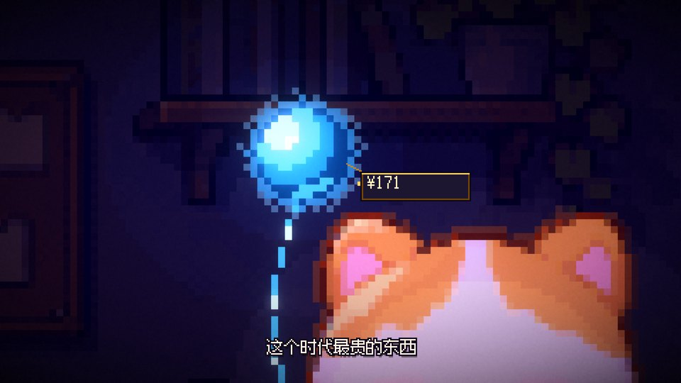
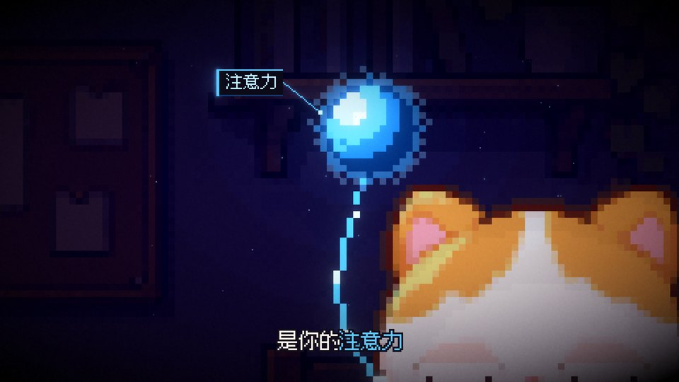

# pixelkit — an HD-2D pixel-art film engine

A deterministic Python renderer for 1080p pixel-art explainer films. No game
engine, no GPU shader stack, no timeline UI: `numpy` + OpenCV + `ffmpeg`, with
every shot expressed as a plain Python file that returns a frame for a given time.

It powers a Chinese knowledge-explainer series — six episodes so far, each
scripted, storyboarded, voiced, scored and mastered from this repo.

<p align="center">
  
</p>
<p align="center">
  
  
</p>

<p align="center"><sub>Stills rendered by this engine. Chinese subtitles are burned in at the compositing stage.</sub></p>

## Why it exists

Pixel art in video usually means either a sprite sheet animated in an editor, or a
full game engine imported into an ad-hoc scene. Both are heavy for a 4-minute
episode that needs 40 shots with lighting, camera moves, particles and a synced
score.

The bet here: **a shot is a function of time**. If `frame(t)` is pure, then a film
is a list of functions, rendering is embarrassingly parallel across processes, a
still is just `t = 6.75`, and "does the audio hit the visual beat" becomes an
arithmetic question instead of a review note.

Three files per shot follow from that:

| File | Contract |
| --- | --- |
| `timeline.py` | the **only** source of time: beat grid, event times, camera track, character state, physics |
| `scene.py` | `make(**kw) -> scene`, `scene.frame(t) -> float RGB` at 1080p. Must be stateless in `t` |
| `audio.py` | lays out music and cues **from the same timeline** → `out/*.wav` at −16.5 LUFS |

Both picture and sound read time from one place, which is what keeps a beat drop
on the frame it was written for.

## Rendering

```bash
# stills at arbitrary times (out of order is fine, that is the point)
python -m pixelkit.stills scene.py 0.8,3.05,8.95 --out _work/x/sheet.png

# quality check against the reference film's measured palette / contrast
python -c "from pixelkit import qa; qa.report(r'_work/x/f_06.75.png')"

# audio for the shot, then the full render
python audio.py
python -m pixelkit.render scene.py:make --dur 10.5 --audio out/audio.wav \
    --out out/shot.mp4 --workers 12
```

Workers are processes, each about 1.4 GB at 1080p; the 16-core box this was
developed on runs 12. Preview is cheap: `--frames 90:150`, or half resolution with
`--kw "{\"OW\":960,\"OH\":540}" --crf 20`.

## What is in the engine

| Area | Modules |
| --- | --- |
| Core | `core palette persp materials light camera post particles anim ui blocks scene qa render titles edit shots perform credits` |
| Characters | `characters/claude` (expressions, arm poses, status LED, CRT power-off), `characters/human` (procedural chibi: hair, glasses, stubble, clothing) |
| Sets | `sets/office props dressing` (30+ props), `sets/inserts` (clock close-ups), `sets/street` |
| Audio | `audio/synth music cues master` — beat grid, theme arrangement, cue library, convolution reverb, limiting, loudness normalisation |
| Staging | `templates/opening act1 … act5 egg bridge23 bridge34 full` — from a single shot to a full EDL with matched dissolves |

Scene composition order is fixed and documented: background (with emissive pass) →
mid-ground sprites → lighting → foreground defocus → dust and bloom → colour grade
→ UI on a 480×270 grid scaled ×4. Presets cover golden hour, late afternoon,
sunset, dusk and night, and post grades are named rather than tuned per shot.

## The production method

`docs/` is the other half of the engine: delivery standards, the reference film
teardown, the shot-type catalogue, narration direction rules, and a narrative
method distilled from seven reference films. These are Chinese-language documents
written for the person making the next episode — including future me, three weeks
later, with no memory of why a shot was framed that way.

## Multi-agent orchestration

`tools/dispatch.py` hands a task card to a local agent (DeepSeek API, Codex CLI,
or a Claude Code CLI pointed at a different backend), blocks until it finishes with
a hard timeout, and writes the result next to the prompt. Task cards, logs and
handover notes live in `tools/`, which is what makes it possible to drop a whole
afternoon's work and resume from files instead of memory.

Credentials are read from `tools/secrets.local.json`, which is **not** in this
repo — see `tools/secrets.local.example.json`.

## What is not here

This is a working directory, not a distributable package, and the parts that do not
belong in a public repo were left out:

- **Generated films, stills and plates** (`作品/`, `成片/`, ~10 GB) — rendered output.
- **Reference material** (`参考视频/`) — third-party video, used for study only.
- **Fonts and assets** (`assets/fonts`, `assets/ref`, `assets/plates`) — pixel fonts
  under their own licences, and reference frames from the study film.
- **Voice and audio takes** (`配音相关/`).

So the engine imports and renders, but a template that needs a specific background
plate or voice track will need that file dropped back in. `docs/STYLE_GUIDE.md`
records what the picture is measured against when it is.

## Status

Work in progress, v0.14. Six episodes produced; the engine grows per episode. The
honest gaps: no test suite beyond quality-check reports, Windows-first paths in the
templates, and `docs/HANDOFF.md` still reads like a personal notebook.

## Requirements

Python 3.13, `numpy opencv-python pillow scipy librosa soundfile`, `ffmpeg` on
`PATH`, Node 24 only if you want the JS pixel-effect library (`vendor/pixelfx`,
MIT, not vendored here).

## Licence

No licence yet — all rights reserved. Ask before reusing the code; the artwork and
fonts are not mine to license.
